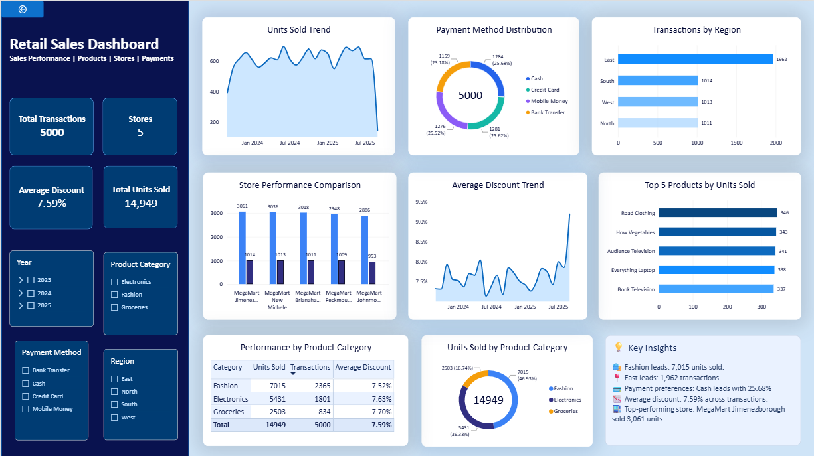

# Retail Sales Data Warehouse & Analytics

**An end-to-end data engineering and business intelligence project using PostgreSQL, dbt, and Power BI.**

[](https://www.postgresql.org/)
[](https://www.getdbt.com/)
[](https://powerbi.microsoft.com/)
[

## Dashboard Preview

The project includes an interactive Power BI dashboard designed to help users explore retail sales activity, product performance, store performance, payment preferences, and discount patterns.



**Dashboard highlights**
- KPI cards for total transactions, units sold, number of stores, and average discount.
- Sales volume trends over time.
- Payment method distribution.
- Transaction comparison across regions.
- Store performance comparison.
- Top five products by units sold.
- Product category performance table.
- Interactive slicers for year, product category, payment method, and region.
- A key insights panel summarizing findings from the dataset.

The Power BI report is available at [`powerbi/retail_sales_dashboard.pbix`](powerbi/retail_sales_dashboard.pbix).

## 1. Project Overview

Retail businesses collect transactional data from customers, products, and stores. Without a structured data pipeline, analyzing this information consistently can be difficult.

This project demonstrates how raw retail data can be loaded into PostgreSQL, transformed into analytics-ready datasets using dbt, organized into a dimensional data warehouse, and presented through an interactive Power BI dashboard.

The goal is to demonstrate practical data engineering concepts, including data ingestion, SQL transformations, dimensional modeling, data quality testing, analytical data marts, and business intelligence reporting.

The project uses a retail sales dataset containing customer, product, store, and transaction information.

### Project objectives

- Organize raw retail data in a PostgreSQL database.
- Create structured staging tables and transformation models.
- Design a dimensional warehouse using fact and dimension tables.
- Build a sales summary data mart for reporting.
- Validate data quality and relationships between tables.
- Develop an interactive Power BI dashboard.
- Maintain project code and documentation in GitHub.

## 2. Technology Stack

| Technology | Purpose |
|---|---|
| PostgreSQL | Relational database and data warehouse |
| SQL | Data loading, transformation, analysis, and validation |
| dbt Core | Modular SQL transformations, model dependencies, and testing |
| dbt-postgres | PostgreSQL adapter for dbt |
| Power BI Desktop | Interactive dashboard and business intelligence |
| Python | Supporting environment and data preparation, where applicable |
| Git | Version control |
| GitHub | Source code hosting and project documentation |

## 3. Architecture

The project follows a layered data warehouse architecture.

```text
              Retail Sales Dataset
             (Excel / CSV Files)
                      |
                      v
              PostgreSQL Database
                      |
                      v
                 RAW Layer
       Customers | Products | Stores
                 Transactions
                      |
                      v
               STAGING Layer
       Cleaning, standardization, and
          consistent column naming
                      |
                      v
              WAREHOUSE Layer
             Dimension Tables
                      |
                      v
                Fact Sales
                      |
                      v
              MARTS Layer
           Sales Summary Mart
                      |
                      v
                  Power BI
       Interactive Dashboard & Insights
```

The SQL scripts in the `database/` directory document the manual database setup and loading workflow. The dbt project provides modular staging, warehouse, and mart transformations.

## 4. Dataset Description

The source workbook contains four datasets.

| Dataset | Rows | Description |
|---|---:|---|
| Customers | 200 | Customer identifiers, names, gender, birth dates, cities, and join dates |
| Products | 50 | Product identifiers, names, categories, subcategories, unit prices, and cost prices |
| Stores | 5 | Store identifiers, names, cities, and regions |
| Transactions | 5,000 | Transaction identifiers, dates, customer and product references, store references, quantities, discounts, and payment methods |

**Total source transaction records: 5,000.**

The transaction dates range from September 10, 2023, to September 9, 2025.

Initial data validation checked for missing values, duplicate rows, duplicate source identifiers, and invalid foreign-key references. The initial checks found no missing values, duplicate full rows, or unmatched customer, product, and store references.

These checks describe the supplied dataset; they do not guarantee that future incoming data will always be valid.

## 5. Data Engineering Workflow

### Step 1: Raw data ingestion

The source datasets were loaded into PostgreSQL under the `raw` schema.

Raw tables:
- `raw.customers`
- `raw.products`
- `raw.stores`
- `raw.transactions`

The raw layer preserves the source data as the starting point for downstream processing.

### Step 2: Staging transformations

The staging layer standardizes source data and provides consistent models for downstream transformations.

The dbt staging models are:

- `stg_customers.sql`
- `stg_products.sql`
- `stg_stores.sql`
- `stg_transactions.sql`

Transformations include consistent column naming and trimming identifier and text fields where appropriate.

The staging models reference the raw tables through dbt source definitions in `models/sources.yml`.

### Step 3: Dimensional warehouse modeling

The warehouse layer organizes the data into dimension tables and a central sales fact table.

**Dimension tables**

| Model | Purpose |
|---|---|
| `dim_customers.sql` | Customer attributes |
| `dim_product.sql` | Product attributes and categories |
| `dim_store.sql` | Store and regional attributes |
| `dim_date.sql` | Calendar attributes for time-based analysis |
| `dim_payment_method.sql` | Payment method descriptions |

**Fact table**

`fact_sales.sql` records transaction-level sales activity and connects each transaction to the relevant dimension records.

The fact model uses dimension keys to support analytical queries across dates, customers, products, stores, and payment methods.

The manually loaded warehouse tables were validated against the source data:

- Customer dimension: 200 records
- Product dimension: 50 records
- Store dimension: 5 records
- Date dimension: 729 records
- Payment method dimension: 4 records
- Sales fact: 5,000 records

The date dimension covers the calendar range used in the supplied transaction dataset.

### Step 4: Sales summary data mart

The dbt model `mart_sales_summary.sql` creates an analytics-ready dataset by joining the fact table with the relevant dimensions.

The mart summarizes sales activity at the following grain:

**One row per date, product, store, and payment method combination.**

The model includes:

- Date, year, quarter, and month
- Product identifier, product name, and category
- Store identifier, store name, and region
- Payment method
- Transaction count
- Units sold
- Average discount

This mart serves as the primary reporting source for the Power BI dashboard.

The mart is designed for sales-volume and transaction analysis. It is not a revenue or profit fact table.

## 6. Data Quality and Testing

Data quality is important because incorrect joins, duplicate keys, or missing dimension records can produce misleading reports.

The project includes validation SQL scripts and dbt tests.

### Database validation

The `database/` scripts cover:
- Raw data validation
- Staging data validation
- Dimension validation
- Fact table validation
- Sales analysis queries

### dbt testing

The project includes YAML-based model tests for the staging and warehouse layers.

The implemented tests include checks such as:

- `not_null` for required columns
- `unique` for key columns
- `relationships` for fact-to-dimension references

These tests help detect missing keys, duplicate identifiers, and invalid dimension relationships.

The staging, warehouse, and sales summary mart models were run and tested during development, and the implemented tests passed.

## 7. Power BI Dashboard

The dashboard connects to the PostgreSQL sales summary mart and presents the data through interactive visuals.

### KPI cards

- **Total Transactions:** 5,000
- **Total Units Sold:** 14,949
- **Stores:** 5
- **Average Discount:** approximately 7.59%

### Visualizations

| Visualization | Business purpose |
|---|---|
| Units Sold Trend | Explore how sales volume changes over time |
| Payment Method Distribution | Compare transaction counts by payment method |
| Transactions by Region | Compare transaction activity across regions |
| Store Performance Comparison | Compare units sold and transaction counts by store |
| Average Discount Trend | Explore discount patterns over time |
| Top 5 Products by Units Sold | Identify the five products with the highest sales quantities |
| Units Sold by Product Category | Compare sales volume across product categories |
| Performance by Product Category | Compare units sold, transaction counts, and average discounts |

### Interactive filtering

The report includes slicers for:
- Year
- Product category
- Payment method
- Region

These filters allow users to explore different parts of the dataset without modifying the underlying SQL models.

### Example findings

The following findings are based on the supplied dataset and current report:

- Fashion recorded 7,015 units sold, making it the largest category by sales quantity.
- The East region recorded 1,962 transactions.
- MegaMart Jimenezborough recorded 3,061 units sold, the highest total among the five stores.
- Cash represented 25.68% of transactions, narrowly ahead of the other payment methods.
- The overall weighted average discount was approximately 7.59%.

These are descriptive findings from the dataset, not evidence of causation or year-over-year growth.

## 8. Important Data Limitations

The source data does not contain the actual unit price or cost price applied to each transaction. Prices and costs are available only as product-level attributes in the supplied product dataset.

Consequently, the project does **not** claim historically accurate transaction revenue, gross profit, or profit margin.

Using current product prices to calculate historical financial performance could introduce errors if prices or costs changed over time. A production-grade extension would capture transaction-level price and cost snapshots, or maintain appropriate historical product versions.

The project also does not include a complete automated orchestration or production deployment pipeline. Its focus is on the database, transformation, modeling, validation, and reporting layers.

## 9. Repository Structure

```text
retail-sales-data-warehouse/
│
├── database/
│   ├── 01_create_schemas.sql
│   ├── 02_create_raw_tables.sql
│   ├── 03_create_staging_tables.sql
│   ├── 04_create_warehouse_tables.sql
│   ├── 05_validate_raw_data.sql
│   ├── 06_load_staging.sql
│   ├── 07_validate_staging.sql
│   ├── 08_load_dimensions.sql
│   ├── 09_validate_dimensions.sql
│   ├── 10_load_fact_sales.sql
│   ├── 11_validate_fact_sales.sql
│   └── 12_sales_analysis.sql
│
├── powerbi/
│   ├── retail_sales_dashboard.pbix
│   └── retail_sales_dashboard.png
│
├── retail_sales_dbt/
│   ├── analyses/
│   ├── macros/
│   ├── models/
│   │   ├── marts/
│   │   │   └── mart_sales_summary.sql
│   │   ├── staging/
│   │   │   ├── stg_customers.sql
│   │   │   ├── stg_products.sql
│   │   │   ├── stg_stores.sql
│   │   │   ├── stg_transactions.sql
│   │   │   └── staging.yml
│   │   ├── warehouse/
│   │   │   ├── dim_customers.sql
│   │   │   ├── dim_date.sql
│   │   │   ├── dim_payment_method.sql
│   │   │   ├── dim_product.sql
│   │   │   ├── dim_store.sql
│   │   │   └── fact_sales.sql
│   │   ├── sources.yml
│   │   └── warehouse.yml
│   ├── seeds/
│   ├── snapshots/
│   ├── tests/
│   ├── .gitignore
│   ├── dbt_project.yml
│   └── README.md
│
├── .gitignore
└── README.md
```

The structure above highlights the main project files. Generated dbt artifacts and local environment files should remain excluded from version control where appropriate.

## 10. Getting Started

### Prerequisites

Install or configure:

- PostgreSQL
- Python
- Git
- dbt Core
- The `dbt-postgres` adapter
- Power BI Desktop for viewing the dashboard

### Step 1: Clone the repository

```bash
git clone https://github.com/ShravyaHegade/retail-sales-data-warehouse.git
cd retail-sales-data-warehouse
```

### Step 2: Configure PostgreSQL

Create the `retail_dw` database and configure your local PostgreSQL connection.

The SQL scripts in `database/` document the schema creation, table creation, loading, and validation process. Follow the script dependencies in numerical order, adapting the loading steps to the location and format of your source files.

The original source workbook is not necessarily included in the repository. If it is not present, obtain the source dataset separately before attempting to reproduce the full pipeline.

### Step 3: Configure dbt

Create and activate a Python virtual environment if you do not already have one.

On Windows Command Prompt:

```cmd
python -m venv .venv
.venv\Scripts\activate.bat
pip install dbt-core dbt-postgres
```

For exact reproducibility, use the compatible package versions documented for the project rather than installing unpinned latest versions.

Configure your dbt profile to connect to the local `retail_dw` database. Store credentials in your local dbt profile or another appropriate secret-management mechanism; do not commit passwords to GitHub.

From the repository root:

```cmd
cd retail_sales_dbt
dbt debug
```

Resolve any connection or profile errors before continuing.

### Step 4: Run dbt models

```cmd
dbt run
```

Run the tests:

```cmd
dbt test
```

The source definitions and model dependencies in the dbt project determine the execution order. Ensure the raw tables have been loaded before running the models.

### Step 5: Open the Power BI report

Open:

`powerbi/retail_sales_dashboard.pbix`

If necessary, configure the PostgreSQL data source using your local database connection. Refresh the report after the models have been created and populated.

The dashboard was developed against the `staging_dbt_marts.mart_sales_summary` relation in the local PostgreSQL setup. If your dbt target schema or schema naming configuration differs, update the connection or model reference accordingly.

## 11. Key Skills Demonstrated

This project demonstrates practical experience with:

- Relational database design
- SQL-based ETL/ELT workflows
- Data ingestion and data validation
- Staging and dimensional data modeling
- Fact and dimension tables
- dbt sources, model references, materializations, and tests
- Analytical data mart development
- Power BI measures, KPI cards, charts, tables, and slicers
- Data storytelling and business insight communication
- Git and GitHub version control
- Technical documentation

## 12. Future Improvements

Potential extensions for a more production-oriented version include:

- Automating ingestion and model execution with Apache Airflow
- Containerizing PostgreSQL and dbt with Docker
- Adding incremental models and robust surrogate-key strategies
- Capturing historical prices and costs for accurate financial reporting
- Implementing a CI workflow to run dbt tests on code changes
- Deploying the warehouse to a cloud platform
- Adding freshness checks, logging, and failure alerts

These are potential future enhancements, not features claimed to be implemented in the current project.

## 13. Author

**Shravya Hegade**

GitHub: [ShravyaHegade](https://github.com/ShravyaHegade)

Repository: [Retail Sales Data Warehouse](https://github.com/ShravyaHegade/retail-sales-data-warehouse)

---

*This project was developed as a practical portfolio project to demonstrate data engineering, analytics engineering, dimensional modeling, and business intelligence skills.*
